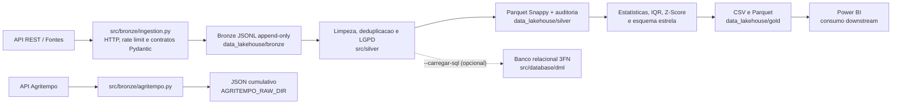

# Arquitetura das camadas de dados

## Fluxo implementado



O orquestrador `src/pipeline_orchestrator.py` lê os lotes JSONL da Bronze, valida e projeta a Silver sem depender do banco e publica os produtos Gold. A carga no SQL 3FN é paralela e opcional. O coletor Agritempo permanece uma coleta Bronze isolada, sem conversão para a Silver.

## Responsabilidade por camada

- **Bronze:** lotes REST JSONL validados por contratos Pydantic e coleta Agritempo em `data_lakehouse/bronze/`; ingestão e contratos ficam em `src/bronze/` e na fachada `src/ingestion.py`.
- **Silver:** normalização, qualidade, deduplicação, UTC e LGPD nos pacotes `src/silver/`; saída Parquet Snappy, cadastros e manifestos de auditoria em `data_lakehouse/silver/`.
- **Banco operacional:** scripts SQL em `sql/` e operações Python em `src/database/dml/`. O banco 3FN é uma persistência operacional separada do Data Lakehouse.
- **Gold:** métricas descritivas, flags IQR/Z-Score, alertas por medição e esquema estrela em `src/gold/`; arquivos publicados em `data_lakehouse/gold/`.
- **Consumo:** `power_bi/` contém tema e recursos de apoio. O modelo semântico e o dashboard ainda precisam ser conectados e entregues no Power BI.

## Módulos alinhados ao diagrama do projeto

- `src/bronze/ingestion.py` implementa o conector REST; `src/ingestion.py` o reexporta.
- `src/silver/quality_governance.py` reúne parsers, governança e persistência Silver; `src/quality_governance.py` o reexporta.
- `src/database/database_manager.py` expõe conexão e operações relacionais; `src/database_manager.py` o reexporta.
- `src/gold/analytics_stat.py` implementa as funções analíticas Gold; `src/analytics_stat.py` as reexporta.
- `src/pipeline_orchestrator.py` executa Bronze → Silver → Gold, com SQL 3FN opcional.
- `tests/test_quality_stat.py` valida outliers, alertas e chaves do esquema estrela.

## Execução

Consulte as opções e pré-condições sem iniciar cargas:

```powershell
python -m src.pipeline_orchestrator --help
```

A execução padrão consome os lotes JSONL da Bronze e não exige SQL Server. Use `--carregar-sql` para replicar também no modelo 3FN (exige schema, parâmetros e estações cadastrados). Para regenerar os relatórios Gold e o esquema estrela a partir da Silver existente:

```powershell
python -m src.pipeline_orchestrator --apenas-gold
```

O pipeline não chama os endpoints REST nem o coletor Agritempo automaticamente. Para executar esses coletores, use `python -m src.ingestion` ou `python -m src.bronze.Get_dados` separadamente.
