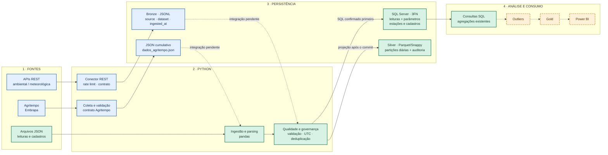

# Fluxo da solução meteorológica e ambiental

Este documento descreve o que está implementado no repositório e separa os
fluxos independentes das etapas ainda pendentes. O diagrama representa a
execução observada no código; portanto, a ordem atualmente executada não é
exatamente `Bronze → qualidade → Silver → banco 3FN`: as cargas de JSON local
persistem no SQL Server 3FN e, após o commit, gravam a projeção Silver.

## Diagrama do fluxo atual e das etapas pendentes

```mermaid
flowchart LR
    subgraph Fontes["Fontes de dados"]
        JSONLocal["JSON local<br/>leituras ambientais, meteorológicas<br/>estados, municípios e estações"]
        REST["Endpoints REST ambiental<br/>e meteorológico configurados"]
        Agritempo["API Agritempo / Embrapa"]
        Operadores["JSON de operadores"]
    end

    subgraph Ingestao["Ingestão e tratamento Python"]
        Menu["src/main.py<br/>orquestra cargas locais"]
        Parsers["Parsers pandas<br/>Parse_LeituraAmbiental.py<br/>Parse_LeituraMetereologica.py"]
        Localizacao["Parse_localizacao_JSON.py<br/>normaliza localização"]
        Coletor["Get_dados.py<br/>coleta e valida contrato Agritempo"]
        Conector["api_ingestion.py<br/>GET, rate limit e contrato"]
        Qualidade["Qualidade e governança<br/>completude, tipos, faixas,<br/>chaves, UTC e deduplicação"]
        Transacao["Persistir_Medicoes.py<br/>valida evento e persiste<br/>cabeçalho + itens em transação"]
    end

    subgraph Bronze["Bronze"]
        BronzeJSONL["JSONL append-only<br/>registros aprovados com source,<br/>dataset e ingested_at<br/>API_RAW_DIR"]
        AgritempoJSON["dados_agritempo.json<br/>JSON cumulativo validado<br/>não é consumido pelas cargas atuais"]
    end

    subgraph SQL["SQL Server — modelo relacional 3FN"]
        LocalSQL["estado → cidade → estacao"]
        CadastroSQL["parametros<br/>operadores protegidos<br/>catalogo_dados LGPD"]
        LeiturasSQL["leituras<br/>leitura_itens"]
    end

    subgraph Silver["Silver — data lake"]
        SilverParquet["Parquet + Snappy<br/>partições por dataset/data UTC<br/>qualidade_agua e leitura_meteorologica"]
        Audit["_audit/<dataset>/*.json<br/>manifestos e métricas agregadas"]
    end

    subgraph Analytics["Analytics e consumo"]
        DQL["consultas-essenciais.sql<br/>agregações e evolução temporal"]
        Outliers["Detecção de outliers/anomalias<br/>NÃO IMPLEMENTADO"]
        Gold["Gold / datasets analíticos<br/>NÃO IMPLEMENTADO"]
        PowerBI["Power BI / dashboards<br/>NÃO IMPLEMENTADO"]
    end

    JSONLocal --> Menu --> Parsers --> Qualidade
    JSONLocal --> Localizacao --> LocalSQL
    Operadores --> CadastroSQL
    Qualidade --> Transacao
    CadastroSQL --> Transacao
    LocalSQL --> Transacao
    Transacao -->|"commit SQL antes da projeção"| LeiturasSQL
    Transacao -->|"DataFrame aceito"| SilverParquet
    SilverParquet --> Audit

    REST --> Conector -->|"contrato validado"| BronzeJSONL
    Agritempo --> Coletor --> AgritempoJSON
    BronzeJSONL -.->|"sem consumidor Bronze→Silver/SQL"| Qualidade
    AgritempoJSON -.->|"sem integração com as cargas 3FN/Silver"| Parsers

    LeiturasSQL --> DQL
    DQL -.-> Outliers -.-> Gold -.-> PowerBI

    classDef implemented fill:#e7f5e9,stroke:#2e7d32,color:#1b1b1b;
    classDef partial fill:#fff8e1,stroke:#ef6c00,color:#1b1b1b;
    classDef missing fill:#ffebee,stroke:#c62828,color:#1b1b1b;
    class BronzeJSONL,AgritempoJSON,Qualidade,Transacao,LeiturasSQL,SilverParquet,Audit,DQL implemented;
    class Conector,Coletor partial;
    class Outliers,Gold,PowerBI missing;
```

As setas contínuas indicam relações presentes no código. As setas pontilhadas
identificam integração ausente ou etapas futuras, não uma execução automática
existente.

## Visão visual resumida para apresentação

O diagrama abaixo simplifica os detalhes de implementação e destaca o caminho
principal, os fluxos paralelos existentes e as etapas futuras. Pode ser usado
como visão geral em uma explicação ou apresentação.

**Legenda:** verde = caminho principal implementado; azul = fluxos paralelos
implementados que ainda não se integram ao caminho principal; laranja
tracejado = etapa planejada/não implementada. A ligação SQL→Silver indica a
ordem real das cargas atuais (commit no banco antes da projeção Silver), e não
uma arquitetura Bronze→Silver→SQL já integrada.

## Como os dados percorrem o projeto

1. **Fontes e ingestão local:** os parsers leem JSONs configurados por
   `INGESTION_LEITURA_AMBIENTAL`, `INGESTION_LEITURA_METEOROLOGICA` e variáveis
   `INGESTION_LOCALIZACAO_*`. `src/main.py` coordena a carga de localização,
   parâmetros e leituras.
2. **REST e Bronze:** `src/ingestion/api_ingestion.py` consulta endpoints
   ambiental/meteorológico configurados por `API_URL_AMBIENTAL` e
   `API_URL_METEOROLOGICA`, aplica limite de requisições e valida os contratos.
   Registros aprovados são gravados em arquivos JSONL com `source`, `dataset` e
   `ingested_at`, no diretório `API_RAW_DIR` (por padrão,
   `src/ingestion/leituras`). Esse conector é independente dos parsers de JSON
   local: não há atualmente uma etapa que leia esses JSONL e os encaminhe à
   Silver ou ao SQL.
3. **Coleta Agritempo:** `Get_dados.py` coleta dados climáticos da API Embrapa,
   valida o contrato e acrescenta resultados em `dados_agritempo.json`. Esse
   fluxo não usa o formato JSONL do conector genérico e não está ligado às
   cargas 3FN/Silver.
4. **Qualidade e governança:** os parsers normalizam JSON em DataFrames, tratam
   timestamps em UTC, verificam campos e domínios dos parâmetros, removem
   retransmissões e registram rejeições. As cargas resolvem referências de
   estação/cidade. Na proteção de operadores, CPF é pseudonimizado com HMAC e
   nome completo é cifrado; os metadados LGPD são mantidos em `catalogo_dados`.
5. **Banco SQL 3FN:** `Persistir_Medicoes.py` valida cada evento e grava
   cabeçalho e itens em transação. O modelo usa `estado`, `cidade`, `estacao`,
   `parametros`, `operadores`, `leituras` e `leitura_itens`, com chaves,
   relacionamentos e restrições definidas em
   `src/database/ddl/create-tables.sql`.
6. **Silver:** depois do commit SQL, os DataFrames aceitos são gravados por
   `Persistir_Silver.py` em Parquet com compressão Snappy, particionados por
   dataset e dia UTC. A escrita é idempotente por chave natural; manifestos em
   `_audit` registram métricas agregadas de qualidade. SQL e Parquet não
   compartilham transação distribuída.
7. **Analytics existente:** `src/database/dql/consultas-essenciais.sql` contém
   consultas de agregação, médias e evolução diária sobre o modelo relacional.
   Elas não constituem uma camada Gold nem um pipeline automatizado de
   analytics.

## Lacunas encontradas

- **Integração da Bronze:** o conector REST grava JSONL, mas não existe leitor ou
  orquestração que conecte esses arquivos à qualidade, à Silver ou ao SQL 3FN.
  Além disso, a persistência contém os registros aprovados envelopados em JSONL,
  não uma cópia integral da resposta HTTP original.
- **Coleta Agritempo isolada:** o JSON acumulado é validado e preservado, porém
  não há transformação que o converta nos contratos das cargas SQL/Silver.
- **Ordem da arquitetura:** no caminho efetivamente executado, o SQL 3FN é
  confirmado antes da gravação Silver. Não há fluxo implementado em que a Silver
  alimente o banco 3FN.
- **Qualidade/governança incompleta:** há validações por campo, unicidade,
  faixas, UTC e integridade referencial, mas o próprio projeto registra que não
  cobre todas as contradições entre fontes/registros. A auditoria de contrato da
  API é feita em logs de aplicação, não como uma trilha de auditoria integrada
  ponta a ponta.
- **Outliers e Gold:** não foi encontrado módulo de detecção de outliers,
  geração/materialização de datasets Gold ou processo agendado de analytics.
  Existem consultas SQL agregadas, mas não uma camada analítica Gold.
- **Power BI:** **NÃO IMPLEMENTADO**. Não há modelo semântico, conexão,
  relatório ou dashboard Power BI no repositório.
- **Status documental divergente:** `features.csv` marca alguns requisitos de
  Bronze (persistência, append-only e metadados) como não iniciados/parciais,
  embora o conector atual grave arquivos JSONL append-only com `source` e
  `ingested_at`. A lacuna remanescente é a preservação integral do payload e,
  principalmente, a integração dessa Bronze ao restante do pipeline.

## Componentes de referência

- `src/main.py` — menu e orquestração das cargas locais.
- `src/ingestion/api_ingestion.py` — ingestão REST genérica e persistência Bronze.
- `Get_dados.py` — coleta separada da API Agritempo.
- `src/ingestion/leituras/Parse_LeituraAmbiental.py` e
  `src/ingestion/leituras/Parse_LeituraMetereologica.py` — parsing e qualidade.
- `src/ingestion/leituras/Persistir_Silver.py` — persistência Parquet e auditoria.
- `src/database/dml/Persistir_Medicoes.py` — gravação transacional do modelo 3FN.
- `src/database/ddl/create-tables.sql` — DDL do banco relacional.
- `src/database/dql/consultas-essenciais.sql` — consultas analíticas existentes.
