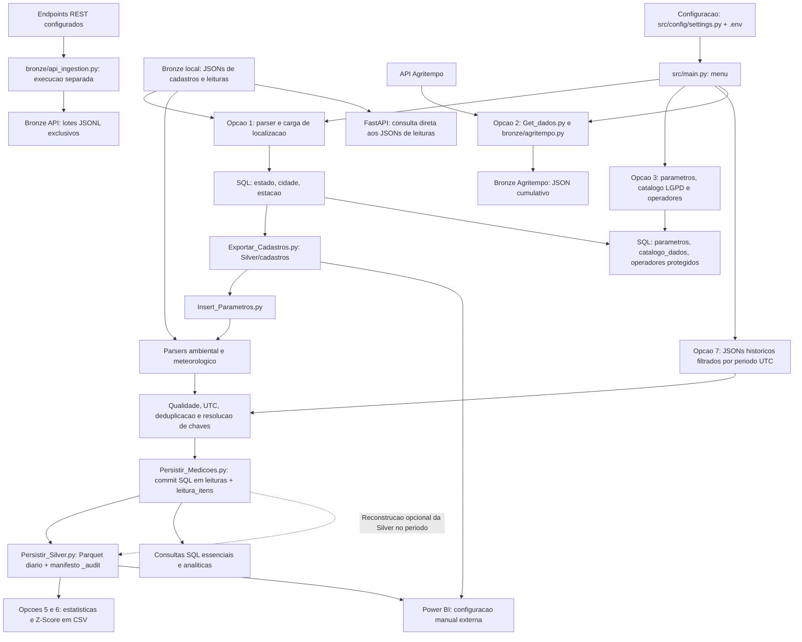

# RunBook operacional PyCoders

Guia para entender, configurar, executar e investigar o pipeline meteorologico e de qualidade da agua. Referencia conferida com o codigo do workspace em 2026-10-21. Os exemplos usam PowerShell no Windows e devem ser executados na raiz do repositorio.

## 1. Como usar este guia

| Necessidade | Onde comecar |
| --- | --- |
| Entender o caminho dos dados | [Fluxograma e explicacao](#2-fluxograma-real-do-projeto) |
| Preparar uma instalacao | [Preparacao](#3-preparacao-do-ambiente) e [configuracao](#4-configuracao) |
| Fazer a primeira carga | [Operacao passo a passo](#5-primeira-execucao-e-rotina-diaria) |
| Executar uma tarefa especifica | [Receitas operacionais](#6-receitas-operacionais) |
| Encontrar o codigo de uma responsabilidade | [Mapa dos arquivos Python](#7-mapa-dos-arquivos-python) |
| Localizar entradas, saidas e SQL | [Mapa de dados e configuracoes](#8-mapa-de-dados-sql-e-arquivos-de-apoio) |
| Investigar uma falha | [Logs e recuperacao](#9-logs-diagnostico-e-recuperacao) |
| Validar uma alteracao sem carregar dados reais | [Testes](#10-testes-e-validacao-segura) |

**Antes de executar:** confirme o banco de destino, os arquivos de entrada e as pastas de saida. Carga, coleta, exportacao, backfill e relatorios escrevem dados. Nao ha modo global de simulacao. Nao copie credenciais, CPF, nomes de operadores ou arquivos pessoais para chamados, commits ou conversas.

## 2. Fluxograma real do projeto

### 2.1 Caminho principal e caminhos independentes



O fluxograma representa dependencias e ordem operacional; nao existe uma transacao unica envolvendo todos os blocos. Na opcao 1, os scripts rodam em sequencia e a sequencia para no primeiro processo que retorna erro. A opcao 4 encerra o menu.

### 2.2 Traducao dos termos

| Termo | Significado neste projeto |
| --- | --- |
| Bronze | Entradas JSON locais, JSON cumulativo Agritempo e lotes REST JSONL; sao formatos diferentes |
| Parser | Funcao que le o JSON, transforma em tabela pandas e aplica normalizacao/validacao |
| ETL | Leitura, tratamento e carga de dados, coordenados pelo menu |
| SQL 3FN | Modelo relacional: entidades separadas e ligadas por chaves; uma leitura tem cabecalho e itens de parametros |
| Silver | Projecao das leituras aceitas em Parquet, mais snapshots de cadastros |
| Parquet/Snappy | Formato tabular e compressao usados nas leituras Silver |
| Gold | Relatorios CSV de estatisticas e Z-Score gerados a partir da Silver |
| Idempotencia/replay | Repetir eventos compativeis sem duplicar suas identidades; nao autoriza sobrescrever valores conflitantes |
| Backfill | Reprocessar um intervalo historico presente nos JSONs operacionais |
| UTC | Referencia de horario usada para normalizar leituras, filtrar periodos e separar dias |
| Manifesto | JSON tecnico com contagens, qualidade e particoes de uma execucao Silver |

### 2.3 Limites que evitam interpretacoes erradas

- O caminho normal e **JSON local -> parser -> SQL confirmado -> Silver -> Gold**. A Silver nao alimenta a carga SQL normal.
- O JSON Agritempo e os JSONL REST **nao sao consumidos automaticamente** pelos loaders SQL/Silver. Coletar pela opcao 2 nao disponibiliza essas observacoes nos relatorios Gold.
- A API FastAPI le os JSONs operacionais; nao consulta SQL, Parquet ou Gold e nao dispara o ETL.
- A opcao 1 nao executa o cadastro de operadores/catalogo LGPD, a coleta, os relatorios ou o Power BI. Cada rotina deve ser acionada separadamente.
- SQL e Parquet nao compartilham transacao distribuida. Uma falha Silver pode acontecer depois de dados ja confirmados no banco.
- Os CSVs Gold existem. O Z-Score Python sinaliza `abs(z) > limiar`; a consulta analitica SQL usa `abs(z) >= 3`. Nao trate os dois indicadores como identicos na fronteira.
- Os recursos Power BI locais sao tema, gerador de fundos e guia. Isso nao significa que exista um relatorio PBIX pronto ou atualizacao automatizada.

## 3. Preparacao do ambiente

### 3.1 Pre-requisitos

- Python: o README declara 3.10+, mas a versao efetiva precisa ser aceita pelas dependencias de [requirements.txt](requirements.txt), inclusive pytest. Se a instalacao indicar incompatibilidade, use uma versao Python compativel com esse manifesto.
- SQL Server acessivel para cargas, cadastros, migracao e exportacao. Apenas gerar Gold, consultar a API JSON ou rodar testes locais nao exige banco operacional.
- **Microsoft ODBC Driver 17 for SQL Server** instalado no Windows. O nome do driver esta fixo em [src/config/settings.py](src/config/settings.py); instalar somente o Driver 18 nao atende a configuracao atual.
- SSMS ou `sqlcmd` para executar SQL com separadores `GO`.
- Token e acesso a internet somente para a fonte externa que sera utilizada.

### 3.2 Ambiente virtual e dependencias

Se o ambiente virtual ja existe, nao e necessario recria-lo. Em uma instalacao nova:

```powershell
python -m venv .venv
.\.venv\Scripts\python.exe -m pip install -r requirements.txt
```

Os comandos deste guia usam o Python do ambiente virtual explicitamente, dispensando ativacao e mudanca de politica de execucao. Para conferir o interpretador e o driver, sem abrir conexao SQL:

```powershell
.\.venv\Scripts\python.exe --version
.\.venv\Scripts\python.exe -c "import pyodbc; print(pyodbc.drivers())"
```

Resultado esperado: interpretador disponivel e `ODBC Driver 17 for SQL Server` na lista. Ausencia do driver deve ser resolvida antes da carga.

### 3.3 Preparar o banco

1. Defina com o responsavel o servidor e o banco de destino. Para uma instalacao nova com o nome padrao, execute [sql/ddl/create-database.sql](sql/ddl/create-database.sql) no SSMS ou `sqlcmd` **somente se `monitoramento` nao existir**.
2. Execute [sql/ddl/create-tables.sql](sql/ddl/create-tables.sql). Confira o `USE` do script antes: se escolheu outro nome de banco, ajuste uma copia de implantacao e a configuracao de forma consistente.
3. Confira a presenca de `estado`, `cidade`, `estacao`, `parametros`, `leituras`, `leitura_itens`, `operadores` e `catalogo_dados`.
4. Em banco antigo, interrompa o procedimento de instalacao nova e revise schema/constraints e necessidade de migracao. O DDL cria tabelas ausentes, mas nao atualiza automaticamente tabelas existentes.

Nao use [sql/ddl/create-legacy-measurements.sql](sql/ddl/create-legacy-measurements.sql) na instalacao: e fixture do legado para testes. Nao use [sql/dml/delete-data-table.sql](sql/dml/delete-data-table.sql) como recuperacao de erro; ele contem operacoes de exclusao. [sql/dml/seed.sql](sql/dml/seed.sql) nao e uma etapa obrigatoria da carga operacional e deve ser revisado antes de qualquer execucao.

## 4. Configuracao

### 4.1 Arquivo de ambiente

[.env.example](.env.example) e o modelo sem segredos. O arquivo local de destino e `src/config/.env`, carregado automaticamente por [src/config/settings.py](src/config/settings.py). Nunca exiba seu conteudo completo em logs ou chamados.

Este comando copia o modelo apenas se ainda nao houver configuracao:

```powershell
if (-not (Test-Path .\src\config\.env)) {
    Copy-Item .\.env.example .\src\config\.env
}
```

Edite os valores locais antes das cargas. Variaveis ja definidas no processo prevalecem sobre o arquivo carregado por `load_dotenv`; alterar apenas o arquivo pode nao mudar uma variavel exportada no terminal. Reinicie processos longos, como a API, depois de alterar configuracoes.

### 4.2 Variaveis e seus consumidores

| Variavel | Funcao / valor de referencia | Consumidor |
| --- | --- | --- |
| `LOGS_DIR` | Pasta dos logs; `logs`; obrigatoria nas rotinas que configuram logging | `configure_logging` |
| `DB_HOST` | Servidor, IP ou instancia, por exemplo `.\SQLEXPRESS` | `create_db_engine` |
| `DB_PORT` | Porta, normalmente `1433`; chave exigida mesmo com instancia nomeada | `create_db_engine` |
| `DB_NAME` | Banco operacional; exemplo `monitoramento` | `create_db_engine` |
| `DB_TRUSTED_CONNECTION` | Exemplo `yes`: autenticacao integrada do usuario Windows | `create_db_engine` |
| `INSERT_LOCALIZACAO` | Caminho de [Insert_Localizacao.py](src/database/dml/Insert_Localizacao.py) | Menu, opcao 1 |
| `INSERT_LEITURA_AMBIENTAL` | Caminho de [Insert_Leituras_ambiental.py](src/database/dml/Insert_Leituras_ambiental.py) | Menu, opcao 1 |
| `INSERT_LEITURA_METEOROLOGICA` | Caminho de [Insert_Leituras_Meteorologica.py](src/database/dml/Insert_Leituras_Meteorologica.py) | Menu, opcao 1 |
| `INGESTION_LOCALIZACAO_ESTADOS` | JSON de estados | Parser de localizacao |
| `INGESTION_LOCALIZACAO_MUNICIPIOS` | JSON de municipios | Parser de localizacao |
| `INGESTION_LOCALIZACAO_ESTACOES` | JSON de estacoes | Parser de localizacao |
| `INGESTION_LEITURA_AMBIENTAL` | JSON operacional ambiental | Parser ambiental, API e backfill |
| `INGESTION_LEITURA_METEOROLOGICA` | JSON operacional meteorologico | Parser meteorologico, API e backfill |
| `SILVER_DIR` | Padrao `data_lake/silver`; Parquets e auditoria | Writers, exportador, Gold |
| `AGRITEMPO_BEARER_TOKEN` | Token secreto Agritempo | Coletor Agritempo |
| `AGRITEMPO_RAW_DIR` | Padrao `data_lake/bronze/agritempo` | Coletor Agritempo |
| `API_RAW_DIR` | Padrao `data_lake/bronze/api` | Conector REST generico |
| `API_REQUESTS_PER_MINUTE` | Padrao `30`; limite de requisicoes | Agritempo e REST |
| `API_TIMEOUT_SECONDS` | Padrao `15`; timeout REST; Agritempo usa 15 segundos no codigo | REST generico |
| `API_URL_AMBIENTAL`, `API_URL_METEOROLOGICA` | URLs opcionais; habilitam cada fonte REST | REST generico |
| `API_SOURCE_NAME_AMBIENTAL`, `API_SOURCE_NAME_METEOROLOGICA` | Rotulos opcionais da origem | Metadados Bronze REST |
| `API_TOKEN_AMBIENTAL`, `API_TOKEN_METEOROLOGICA` | Tokens opcionais suportados pelo codigo, ausentes no modelo atual | REST generico |
| `HMAC_SECRET_KEY` | Segredo real para pseudonimizar CPF; nao usar marcador do modelo | Loader de operadores / `hash_cpf` |
| `ENCRYPTION_KEY` | Chave Fernet real para nomes; nao usar marcador do modelo | Loader de operadores / `encrypt_name` |
| `RUN_SQLSERVER_LGPD_TESTS` | `0` desabilita integracoes; `1` habilita | Testes SQL opt-in |
| `SQLSERVER_LGPD_TEST_URL` | URL SQLAlchemy exclusiva do banco descartavel | Lifecycle de testes SQL |

Regras importantes de [src/config/settings.py](src/config/settings.py): `get_env` falha se uma chave obrigatoria esta vazia; `get_path` resolve caminhos relativos pela raiz do projeto. Os destinos Bronze/Silver possuem os padroes indicados. O driver ODBC e fixo, e nao ha suporte implementado a `DB_USER`/`DB_PASSWORD`. Para `DB_HOST` com barra de instancia, a porta nao e concatenada ao servidor; sem barra, usa `host,porta`.

### 4.3 Configuracoes que ficam no codigo

| Onde | O que procurar | Quando revisar |
| --- | --- | --- |
| [src/bronze/agritempo.py](src/bronze/agritempo.py) | `CONFIGURACOES_BUSCA`, `DATA_INICIAL`, `DATA_FINAL`, `NOME_ARQUIVO_JSON` | Mudar municipios/UFs e periodo da coleta; nao existem flags CLI para isso |
| [src/bronze/api_ingestion.py](src/bronze/api_ingestion.py) | `CONTRATOS`, validadores Agritempo e `validar_registro` | Entender o formato aceito por cada fonte |
| [src/database/dml/Insert_Parametros.py](src/database/dml/Insert_Parametros.py) | `CATALOGO_PARAMETROS` | Conferir codigos, unidades e parametros suportados |
| [src/database/dml/Persistir_Medicoes.py](src/database/dml/Persistir_Medicoes.py) | `MAPEAMENTO`, `preparar_evento`, `carregar_dataframe` | Conferir conversao de medidas em cabecalho/itens |
| [src/silver/leituras/Persistir_Silver.py](src/silver/leituras/Persistir_Silver.py) | `CONTRATOS_DATASETS`, `persistir_silver` | Conferir schema, chaves e regras Silver |
| [src/database/dml/Insert_Operadores.py](src/database/dml/Insert_Operadores.py) | `OPERADORES_JSON` | Fonte padrao de operadores, fora das variaveis `INGESTION_*` |
| [src/database/dml/Insert_Localizacao.py](src/database/dml/Insert_Localizacao.py) | `modo_carga = "append"` | Preserva cadastros existentes; mudar para `replace` exclui estacoes/cidades/estados e reinicia IDs, podendo falhar por FKs ou invalidar vinculos historicos |

Nao altere regras de qualidade ou catalogos apenas para fazer uma carga passar. Mudancas nesses contratos exigem revisao e testes.

## 5. Primeira execucao e rotina diaria

### 5.1 Verificacoes antes da execucao

1. Confirme a raiz do repositorio, o ambiente virtual, as dependencias e o ODBC.
2. Confirme com o responsavel o destino `DB_*` e as pastas `SILVER_DIR`/`LOGS_DIR`, sem publicar credenciais.
3. Confirme que os cinco JSONs de localizacao/leituras configurados existem e correspondem ao lote esperado. Confirme a disponibilidade do schema SQL.
4. Para operadores, confirme as estacoes de referencia, o JSON de operadores e as chaves HMAC/Fernet. Guarde essas chaves em local seguro: troca de HMAC altera identidades e perda de Fernet impede recuperar nomes cifrados.
5. Para reprocessamento, migracao ou reconstrucao, providencie backup consistente do banco, JSONs historicos e Silver antes de executar. Nao rode writers Silver durante a geracao Gold.

### 5.2 Abrir o menu

```powershell
.\.venv\Scripts\python.exe .\src\main.py
```

| Opcao | O que executa | Resultado e dependencia |
| --- | --- | --- |
| `1` | Localizacao -> parametros -> ambiental -> meteorologica | SQL e Parquets; depende de JSONs, SQL/ODBC e configuracao; localizacao tambem exporta cadastros |
| `2` | Entrada [Get_dados.py](Get_dados.py) | Coleta Agritempo; grava JSON cumulativo; exige bearer/internet |
| `3` | Parametros -> catalogo LGPD -> operadores | Cadastros SQL; exige estacoes existentes e chaves reais para operadores |
| `4` | Encerra o menu | Nao desfaz nenhuma etapa ja executada |
| `5` | Estatisticas descritivas | Le Silver e substitui CSV padrao, sem consultar SQL |
| `6` | Z-Score, limiar padrao 3 | Le Silver e substitui CSV Z-Score, sem consultar SQL |
| `7` | Backfill por dataset e intervalo; pergunta se reconstrói Silver | Grava SQL/Silver nos destinos operacionais configurados |

### 5.3 Ordem recomendada para a primeira carga local

1. Execute a opcao `1`. Ela cadastra localizacao e parametros antes das leituras. Se falhar, consulte o log de insercao e corrija antes de seguir.
2. Execute a opcao `3` se o cadastro LGPD/operadores fizer parte da operacao. Ela nao e pre-requisito automatico de todas as leituras: o modelo admite operador opcional.
3. Confira SQL, Parquets e manifestos conforme a secao seguinte.
4. Execute `5` e depois `6`, se precisar das duas saidas Gold. Nao e necessario gerar o CSV descritivo antes do Z-Score: o segundo calcula sua propria referencia em memoria.
5. Atualize o Power BI manualmente ou inicie a API, conforme o consumo desejado. Eles sao processos independentes.

Para uma rotina diaria com novos JSONs, preserve as entradas anteriores para replay, disponibilize o lote operacional aprovado, repita a carga e confira logs/manifestos. A coleta externa so deve ser executada se aquela Bronze for realmente necessaria; nao substitui a preparacao dos JSONs operacionais.

### 5.4 Como reconhecer o sucesso

A carga meteorologica mostra `Meteorologia: 0/2910 leituras processadas`,
atualiza a cada 100 leituras e mostra o total final (o denominador depende do
lote aprovado pelo parser). A saida aparece durante a execucao, tanto pelo menu
quanto pela chamada direta ao script. Processadas inclui insercoes, retransmissoes
identicas e rejeicoes registradas; nao significa quantidade inserida. Uma falha
tecnica interrompe a contagem. O total final indica fim da etapa SQL, nao sucesso
da Silver: aguarde o resumo `Carga meteorologica 3FN` para confirmar o termino.

| Etapa | Evidencia esperada |
| --- | --- |
| Localizacao | Cadastros SQL presentes e snapshots `estados.parquet`, `cidades.parquet`, `estacoes.parquet` atualizados na Silver |
| Leituras | Cabecalhos/itens SQL compativeis, Parquets por dia UTC e novos manifestos em `_audit` |
| Operadores | Logs de carga sem exposicao pessoal; SQL com CPF protegido e nome cifrado, nunca nome/CPF em claro |
| Gold | CSV desejado atualizado, log de conclusao e grupos/periodo coerentes com a Silver |
| Agritempo | Log com novos/acumulados e JSON cumulativo valido; zero novos registros nao prova coleta util |
| REST | Lotes JSONL publicados e contagens de aprovados/rejeitados verificadas |
| API | Documentacao abre e endpoints retornam JSON esperado |

Nao use apenas a existencia de um arquivo antigo como prova de sucesso. Compare horario, periodo, contagens e logs. No menu, erros de subprocessos sao registrados, mas o menu continua aberto; sair normalmente nao prova que todas as cargas passaram. Scripts tambem podem registrar rejeicoes por registro: confira os resultados alem do codigo de saida.

## 6. Receitas operacionais

### 6.1 Executar somente uma etapa SQL

**Grava no banco configurado.** Use para diagnostico ou retomada, respeitando a dependencia de localizacao e parametros. Os loaders de leituras tambem gravam Silver.

```powershell
.\.venv\Scripts\python.exe -m src.database.dml.Insert_Localizacao
.\.venv\Scripts\python.exe -m src.database.dml.Insert_Parametros
.\.venv\Scripts\python.exe -m src.database.dml.Insert_Leituras_ambiental
.\.venv\Scripts\python.exe -m src.database.dml.Insert_Leituras_Meteorologica
```

Esses sao comandos separados: pare ao primeiro erro e investigue antes do proximo. No PowerShell, confira `$LASTEXITCODE` imediatamente depois de cada comando. Nao use os modulos de baixo nivel de cabecalho/itens para contornar a validacao dos loaders.

### 6.2 Exportar apenas cadastros para Parquet

```powershell
.\.venv\Scripts\python.exe -m src.silver.localizacao.Exportar_Cadastros
```

Consulta o SQL configurado e substitui os tres snapshots em `SILVER_DIR/cadastros`, sem alterar SQL nem Parquets de leituras. Cadastros vazios impedem a exportacao. Os IDs sao os do banco, nao os recalculados dos JSONs. Use o mesmo banco das leituras; se seus IDs foram recriados, reconcilie o historico antes de relacionar os arquivos.

### 6.3 Gerar estatisticas e Z-Score

```powershell
.\.venv\Scripts\python.exe -m src.gold.analytics_statistics
.\.venv\Scripts\python.exe -m src.gold.analytics_statistics --analise zscore
```

Recorte personalizado, em dois comandos independentes:

```powershell
.\.venv\Scripts\python.exe -m src.gold.analytics_statistics --data-inicio 2026-10-01 --data-fim 2026-10-14 --saida data_lake/gold/estatisticas_outubro.csv
.\.venv\Scripts\python.exe -m src.gold.analytics_statistics --analise zscore --limiar 2.5 --data-inicio 2026-10-01 --data-fim 2026-10-14 --saida data_lake/gold/z_scores_outubro.csv
```

**Gold inclui as duas datas**, em dias UTC: o exemplo inclui o dia 14 inteiro. `--silver-dir` permite escolher outra origem. O CSV usa `;`, decimal `.`, UTF-8 com BOM e substituicao do destino. Nunca aponte `--saida` para a Silver ou use o mesmo destino para dois relatorios que deseja preservar.

As estatisticas agrupam por dataset, estacao, parametro e unidade; desvio/variancia sao amostrais (`ddof=1`). Amostra insuficiente ou desvio zero produzem Z-Score indefinido, nao prova de ausencia de anomalias. A classificacao e estatistica, nao um laudo fisico/sanitario. O Python nao grava flags no banco ou na Silver.

### 6.4 Reprocessar um periodo

**Grava no banco operacional e na Silver configurados.** Antes, valide com dados sinteticos em ambiente isolado. Os JSONs devem conter o historico; nao ha busca automatica nas APIs.

```powershell
.\.venv\Scripts\python.exe -m src.database.dml.Backfill_Leituras --dataset ambos --data-inicio 2026-09-15 --data-fim 2026-09-18
```

Datasets aceitos: `ambiental`, `meteorologica`, `ambos`. **Backfill exclui a data final**: o exemplo processa os dias 15, 16 e 17 UTC, nao o dia 18. A data de referencia e a da leitura, nao a da ingestao.

Repetir o intervalo no modo padrao preserva eventos ja aceitos, rejeita conflitos e pode reparar projecao Silver ausente. O processamento nao e atomico para o periodo inteiro; eventos ja confirmados nao sao desfeitos se outro evento falhar.

### 6.5 Reconstruir particoes Silver pela referencia SQL

**Substitui integralmente as particoes afetadas.** Exige backup, investigacao da divergencia e banco de referencia correto.

```powershell
.\.venv\Scripts\python.exe -m src.database.dml.Backfill_Leituras --dataset ambos --data-inicio 2026-09-15 --data-fim 2026-09-18 --reconstruir-silver
```

Primeiro roda o backfill dos JSONs; depois consulta todos os eventos SQL aceitos no periodo, inclusive os ausentes do lote JSON. Rejeicoes da carga impedem a reconstrucao do dataset afetado. Dias sem eventos SQL podem ter um arquivo existente substituido por Parquet vazio. Dias fora do intervalo sao preservados. O manifesto registra `reconstrucao_sql`.

A substituicao e atomica por arquivo, nao pelo intervalo inteiro. Se falhar no meio, investigue e repita o mesmo periodo. Nao apague arquivos `.silver.lock`: o lock pertence ao processo/sistema operacional. Parquets extras, arquivos corrompidos e colisoes de chave exigem investigacao, nao exclusao automatica.

### 6.6 Coletar dados externos

Agritempo, tambem disponivel pela opcao `2`:

```powershell
.\.venv\Scripts\python.exe .\Get_dados.py
```

Configure bearer no ambiente local e confira municipios/periodo nas constantes de [src/bronze/agritempo.py](src/bronze/agritempo.py). A rotina regrava o JSON cumulativo preservando e acrescentando resultados; nao garante deduplicacao entre coletas repetidas. Nao confunda esse comportamento com lotes imutaveis.

REST generico, fora do menu:

```powershell
.\.venv\Scripts\python.exe -m src.bronze.api_ingestion
```

Exige pelo menos uma URL `API_URL_*`; os endpoints precisam cumprir os contratos do modulo. Cada registro aceito vira uma linha com `record`, `dataset`, `source`, `ingested_at` em lote JSONL exclusivo. Rejeicoes ficam no log, sem gravar o payload completo. Nenhum desses dois comandos executa a carga SQL/Silver.

### 6.7 Iniciar a API de consulta JSON

```powershell
.\.venv\Scripts\python.exe -m uvicorn src.api.main:app --host 127.0.0.1 --port 8000 --reload
```

Abra <http://127.0.0.1:8000/docs>. Endpoints: `/`, `/cidades`, `/leituras/ambientais` e `/leituras/meteorologicas`. As duas consultas de leituras aceitam filtro `cidade`. Encerre com `Ctrl+C`. Se a porta estiver ocupada, escolha outra em `--port`.

O servidor consulta JSONs configurados, nao o SQL/Silver. Mantenha-o local: este comando de desenvolvimento nao configura autenticacao, TLS ou publicacao segura. `--reload` e para desenvolvimento.

### 6.8 Migracao do legado: somente procedimento controlado

[src/database/dml/Migrar_Leituras.py](src/database/dml/Migrar_Leituras.py) e diferente de backfill. Leia a secao de migracao do [README.md](README.md) e confira a ajuda antes de planejar a execucao:

```powershell
.\.venv\Scripts\python.exe -m src.database.dml.Migrar_Leituras --help
```

A CLI exige `--expected-database` e `--confirm`; `--arquivar` adiciona arquivamento do legado apos reconciliacao. Nao rode contra dados reais sem backup, revisao de schema e autorizacao do responsavel. Nao crie tabelas legadas para tentar resolver uma carga normal.

### 6.9 Power BI

Importe os tres cadastros separadamente e combine as particoes de cada dataset de leituras separadamente. Crie relacionamentos de um para muitos, com filtro unidirecional, respeitando as colunas abaixo:

```text
estados[id_estado]   -> cidades[id_estado]
cidades[id_cidade]   -> estacoes[id_cidade]
estacoes[id_estacao] -> leitura_meteorologica[id_estacao]
estacoes[id_estacao] -> qualidade_agua[id_estacao]
```

Nao crie outro caminho ativo direto cidade -> meteorologia. Atualize Parquets antes de clicar em Atualizar no Power BI. Tema, layout, medidas e navegacao estao em [power_bi/GUIA.md](power_bi/GUIA.md); isso exige montagem manual dos visuais.

## 7. Mapa dos arquivos Python

Os nomes sao literais, inclusive `Metereologica` no parser. O mapa abaixo inclui arquivos operacionais, auxiliares e testes; modulos auxiliares nao sao etapas a executar isoladamente.

### 7.1 Entradas, configuracao e coleta

| Arquivo | Responsabilidade e ponto para procurar |
| --- | --- |
| [src/main.py](src/main.py) | `MENU`, `main`, `executar_script`: escolhe e executa subprocessos com o mesmo interpretador; nao faz o tratamento dos dados |
| [Get_dados.py](Get_dados.py) | Entrada de compatibilidade do coletor Agritempo; implementacao fica no pacote Bronze |
| [src/config/settings.py](src/config/settings.py) | `PROJECT_ROOT`, `get_env`, `get_path`, getters de diretorios, `create_db_engine`, `configure_logging` |
| [src/bronze/agritempo.py](src/bronze/agritempo.py) | Constantes da coleta, `buscar_estacoes`, `buscar_dados_climaticos`, `salvar_resultados_append`, `main` |
| [src/bronze/api_ingestion.py](src/bronze/api_ingestion.py) | Contratos REST/Agritempo, `LimiteRequisicoes`, `ingerir_endpoint`, gravacao JSONL e `main` |
| [src/api/main.py](src/api/main.py) | Aplicacao `app`, `carregar_e_normalizar` e rotas HTTP sobre JSON |

### 7.2 Tratamento e Silver

| Arquivo | Responsabilidade e ponto para procurar |
| --- | --- |
| [src/silver/localizacao/Parse_localizacao_JSON.py](src/silver/localizacao/Parse_localizacao_JSON.py) | `tabela_estado`, `tabela_cidade`, `tabela_estacao`: leitura/normalizacao dos cadastros; tambem referencia `carregar_operadores` |
| [src/silver/localizacao/Exportar_Cadastros.py](src/silver/localizacao/Exportar_Cadastros.py) | `CONSULTAS`, `exportar_cadastros`: SQL -> snapshots Parquet com IDs preservados |
| [src/silver/leituras/Parse_LeituraAmbiental.py](src/silver/leituras/Parse_LeituraAmbiental.py) | `ler_json`, `tabela_ambiental`: tratamento de leituras de agua |
| [src/silver/leituras/Parse_LeituraMetereologica.py](src/silver/leituras/Parse_LeituraMetereologica.py) | `ler_json`, `tabela_metereologica`: tratamento das leituras meteorologicas |
| [src/silver/leituras/Persistir_Silver.py](src/silver/leituras/Persistir_Silver.py) | `CONTRATOS_DATASETS`, `persistir_silver`, `reconstruir_particoes_silver`: validacao, particoes UTC, locks, escrita atomica e auditoria |

Faixas relevantes: ar de -50 a 60 graus Celsius, agua de 0 a 50, pH de 0 a 14, umidade de 0 a 100; chuva, vento, oxigenio e condutividade nao negativos. Valores nao finitos, identidades ausentes e referencias invalidas sao rejeitados conforme o contrato. Leia parser e writer para diagnosticar a etapa exata da rejeicao.

### 7.3 Cargas e persistencia SQL

| Arquivo | Responsabilidade e ponto para procurar |
| --- | --- |
| [src/database/dml/Insert_Localizacao.py](src/database/dml/Insert_Localizacao.py) | `limpar_localizacao`, `inserir_localizacao`, `inserir_estacoes`: cadastros e exportacao Silver apos commit; revise o modo de carga antes de alterar |
| [src/database/dml/Insert_Parametros.py](src/database/dml/Insert_Parametros.py) | `CATALOGO_PARAMETROS`, `inserir_parametros`: cadastro de codigos/unidades antes das leituras |
| [src/database/dml/Insert_Leituras_ambiental.py](src/database/dml/Insert_Leituras_ambiental.py) | `inserir_dados`: parser ambiental -> carga canonica -> Silver; inclui auxiliar de resolucao de estacao |
| [src/database/dml/Insert_Leituras_Meteorologica.py](src/database/dml/Insert_Leituras_Meteorologica.py) | `inserir_dados`: parser meteorologico -> carga canonica -> Silver; inclui auxiliar de resolucao de cidade |
| [src/database/dml/Persistir_Medicoes.py](src/database/dml/Persistir_Medicoes.py) | `preparar_evento`, `persistir_evento`, `carregar_dataframe`, `consultar_medicoes_periodo`: coordena eventos, FKs, transacoes, replays/conflitos e referencia de reconstrucao |
| [src/database/dml/Insert_Leituras.py](src/database/dml/Insert_Leituras.py) | `chave_natural_leitura`, `inserir_leituras`: normalizacao e persistencia do cabecalho; auxiliar do fluxo canonico |
| [src/database/dml/Insert_Leitura_Itens.py](src/database/dml/Insert_Leitura_Itens.py) | `inserir_leitura_itens`: validacao e persistencia das medidas por parametro; auxiliar do fluxo canonico |
| [src/database/dml/etl_lock.py](src/database/dml/etl_lock.py) | `adquirir_lock_etl`: coordenacao SQL Server com application lock entre escritores cooperantes |
| [src/database/dml/Backfill_Leituras.py](src/database/dml/Backfill_Leituras.py) | `validar_periodo`, `reprocessar_periodo`, `main`: recorte UTC, carga historica e reconstrucao opcional |
| [src/database/dml/Migrar_Leituras.py](src/database/dml/Migrar_Leituras.py) | `migrar_legado`, `main`: migracao/reconciliacao e arquivamento opcional das medicoes antigas |

### 7.4 LGPD e Gold

| Arquivo | Responsabilidade e ponto para procurar |
| --- | --- |
| [src/security/pii.py](src/security/pii.py) | `normalize_cpf`, `hash_cpf`, `encrypt_name`, `decrypt_name`: validacao de CPF, HMAC, Fernet e descriptografia autorizada/auditada |
| [src/database/dml/Insert_Operadores.py](src/database/dml/Insert_Operadores.py) | `OPERADORES_JSON`, `carregar_operadores`, `inserir_operadores`: vinculo de estacao, status e protecao dos campos pessoais |
| [src/database/dml/Insert_Catalogo_LGPD.py](src/database/dml/Insert_Catalogo_LGPD.py) | `inserir_catalogo_lgpd`: inventario dos dados pessoais e politicas de protecao/acesso |
| [src/gold/analytics_statistics.py](src/gold/analytics_statistics.py) | `ler_medicoes_silver`, `calcular_estatisticas`, `calcular_z_scores`, geradores de relatorio e `main`: leitura Silver, calculo e CSV atomico |

### 7.5 Arquivos de pacote

Os arquivos seguintes identificam pacotes/imports; nao sao comandos operacionais: [src/__init__.py](src/__init__.py), [src/bronze/__init__.py](src/bronze/__init__.py), [src/config/__init__.py](src/config/__init__.py), [src/database/__init__.py](src/database/__init__.py), [src/gold/__init__.py](src/gold/__init__.py), [src/security/__init__.py](src/security/__init__.py), [src/silver/__init__.py](src/silver/__init__.py), [src/silver/leituras/__init__.py](src/silver/leituras/__init__.py) e [src/silver/localizacao/__init__.py](src/silver/localizacao/__init__.py).

### 7.6 Testes e suporte

| Arquivo | O que valida / oferece |
| --- | --- |
| [tests/conftest.py](tests/conftest.py) | Fixtures e isolamento dos dados/destinos temporarios |
| [tests/sqlserver_support.py](tests/sqlserver_support.py) | Conexao, protecoes, lock, criacao/limpeza de tabelas no banco SQL descartavel |
| [tests/test_api.py](tests/test_api.py) | Rotas e respostas da API JSON |
| [tests/test_config_and_main.py](tests/test_config_and_main.py) | Configuracao, caminhos, logs e orquestracao do menu |
| [tests/test_database_loading.py](tests/test_database_loading.py) | Cargas, resolucao de referencias e exportacao de cadastros |
| [tests/test_project_layout.py](tests/test_project_layout.py) | Estrutura, caminhos e entradas de execucao |
| [tests/bronze/test_api_ingestion.py](tests/bronze/test_api_ingestion.py) | Contratos REST, rate limit, metadados e lotes Bronze |
| [tests/bronze/test_get_dados.py](tests/bronze/test_get_dados.py) | Coleta/contrato Agritempo e JSON cumulativo |
| [tests/silver/test_parsers.py](tests/silver/test_parsers.py) | Normalizacao e validacao dos parsers |
| [tests/silver/test_quality_data.py](tests/silver/test_quality_data.py) | Regras de qualidade e metricas nos manifestos |
| [tests/silver/test_silver.py](tests/silver/test_silver.py) | Parquet, particoes, deduplicacao, reconstrucao, locks e recuperacao |
| [tests/silver/test_backfill.py](tests/silver/test_backfill.py) | Periodos UTC, replay, conflitos, recuperacao e cenarios SQL opt-in |
| [tests/silver/test_lgpd.py](tests/silver/test_lgpd.py) | Protecao de operadores, chaves e autorizacao de descriptografia |
| [tests/gold/test_analytics_statistics.py](tests/gold/test_analytics_statistics.py) | Estatisticas, Z-Score, contratos de leitura e CSV |
| [tests/integration/test_sqlserver_lgpd.py](tests/integration/test_sqlserver_lgpd.py) | LGPD no SQL Server real descartavel |
| [tests/integration/test_sqlserver_migration.py](tests/integration/test_sqlserver_migration.py) | Migracao, reconciliacao e consultas analiticas SQL |
| [tests/integration/test_sqlserver_relational_integrity.py](tests/integration/test_sqlserver_relational_integrity.py) | Integridade, relacionamentos e constraints no SQL Server |
| [tests/integration/test_sqlserver_uniqueness.py](tests/integration/test_sqlserver_uniqueness.py) | Unicidade, concorrencia e replay no SQL Server |

## 8. Mapa de dados, SQL e arquivos de apoio

### 8.1 Entradas e saidas

Os caminhos abaixo sao os padroes do modelo de ambiente; confira os destinos efetivos antes da operacao. Pastas e arquivos gerados podem ainda nao existir em uma instalacao nova.

```text
data_lake/
  bronze/
    cadastros/estado.json                  Estados
    cadastros/municipio.json               Municipios
    cadastros/estacoes.json                Estacoes
    cadastros/operadores.json              Dados pessoais: acesso restrito
    leituras/leituras_ambientais.json      Entrada operacional de agua
    leituras/leituras_meteorologicas.json  Entrada operacional meteorologica
    agritempo/dados_agritempo.json         Resultado cumulativo da coleta
    api/api_*.jsonl                       Lotes REST independentes
  silver/
    cadastros/estados.parquet             Snapshot SQL de estados
    cadastros/cidades.parquet             Snapshot SQL de cidades
    cadastros/estacoes.parquet            Snapshot SQL de estacoes
    qualidade_agua/data_leitura=AAAA-MM-DD/part-00000.parquet
    leitura_meteorologica/data_leitura=AAAA-MM-DD/part-00000.parquet
    _audit/<dataset>/*.json               Manifestos de qualidade/execucao
  gold/
    estatisticas_descritivas.csv          Saida padrao da opcao 5
    z_scores.csv                          Saida padrao da opcao 6
logs/                                    Destino padrao LOGS_DIR
```

As chaves Silver sao `id_leitura_origem` para agua e `(id_estacao, data_leitura UTC)` para meteorologia. Os nomes dos datasets Silver nao significam escrita nas tabelas SQL legadas com nomes semelhantes: o destino SQL canonico e `leituras` + `leitura_itens`.

### 8.2 Arquivos SQL, configuracao e documentacao

| Arquivo | Para que serve |
| --- | --- |
| [.env.example](.env.example) | Modelo de configuracao local sem segredos; copiar apenas em instalacao nova |
| [.gitignore](.gitignore) | Ignora ambiente virtual, caches, temporarios, logs, ambiente local e alguns artefatos gerados; nao protege arquivos ja rastreados |
| [requirements.txt](requirements.txt) | Dependencias e intervalos de versao; instalar no ambiente virtual |
| [pytest.ini](pytest.ini) | Define `--basetemp=.pytest_tmp`; o pytest limpa essa pasta ao iniciar |
| [.github/workflows/check-pr-source.yml](.github/workflows/check-pr-source.yml) | GitHub Actions: em PRs para `main`, exige origem `develop`; nao instala dependencias, nao executa testes e nao agenda ETL |
| [sql/ddl/create-database.sql](sql/ddl/create-database.sql) | Criacao inicial do database; nao repetir se ele ja existir |
| [sql/ddl/create-tables.sql](sql/ddl/create-tables.sql) | DDL canonico de tabelas, chaves e restricoes |
| [sql/ddl/create-legacy-measurements.sql](sql/ddl/create-legacy-measurements.sql) | Fixture legado para testes; fora da instalacao normal |
| [sql/dml/seed.sql](sql/dml/seed.sql) | Script de dados; revisar destino e conteudo antes de usar |
| [sql/dml/delete-data-table.sql](sql/dml/delete-data-table.sql) | Exclusao de dados; nao e rotina de correcao/replay |
| [sql/dql/consultas-essenciais.sql](sql/dql/consultas-essenciais.sql) | Consultas relacionais de consumo; conferir banco e filtros |
| [sql/queries_analiticas.sql](sql/queries_analiticas.sql) | Estatisticas e indicadores IQR/Z em consulta SQL; nao persiste flags |
| [power_bi/tema_pycorders.json](power_bi/tema_pycorders.json) | Tema visual para importar no Power BI; nao configura conexao de dados |
| [power_bi/Gerar_Fundos.ps1](power_bi/Gerar_Fundos.ps1) | Gera fundos PNG no Windows com System.Drawing; nao gera PBIX |
| [power_bi/GUIA.md](power_bi/GUIA.md) | Aplicacao do tema/fundos, medidas DAX e posicionamento/navegacao |
| [features.csv](features.csv) | Acompanhamento de requisitos; nao controla execucao |
| [projeto_final.pdf](projeto_final.pdf) | Especificacao de referencia do projeto; nao e configuracao nem comando operacional |
| [README.md](README.md) | Referencia geral e detalhes dos contratos, migracao e testes |
| [Readme_explain.md](Readme_explain.md) | Material explicativo complementar; confira caminhos/comportamento com o codigo atual |
| [FLUXO_SOLUCAO.md](FLUXO_SOLUCAO.md) | Fluxograma historico; contem caminhos/status antigos. Para operar, use o fluxo atual deste RunBook |

A pasta `src/analytics`, se vazia no checkout, nao e o ponto de entrada de analytics. A implementacao usada pelo menu esta em [src/gold/analytics_statistics.py](src/gold/analytics_statistics.py).

## 9. Logs, diagnostico e recuperacao

### 9.1 Onde olhar

| Log em `LOGS_DIR` | Responsabilidade |
| --- | --- |
| `execucao_relatorio.log` | Menu, subprocessos e geracao dos relatorios Gold |
| `insercao_dados.log` | Cargas SQL, cadastros, backfill e validacoes durante a carga |
| `tratamento_dados.log` | Coletas, contratos REST e tratamentos executados isoladamente; exportacao isolada de cadastros |

Os nomes sao definidos em `configure_logging`. A mesma rejeicao de parser pode aparecer no log de insercao quando ocorre dentro de uma carga. Manifestos Silver ficam em `SILVER_DIR/_audit/<dataset>`, nao na pasta de logs.

Para consultar o final dos logs, quando `LOGS_DIR=logs`:

```powershell
Get-Content .\logs\execucao_relatorio.log -Tail 60
Get-Content .\logs\insercao_dados.log -Tail 60
Get-Content .\logs\tratamento_dados.log -Tail 60
```

### 9.2 Sintoma, causa provavel e acao

| Sintoma | Conferir | Acao segura |
| --- | --- | --- |
| `ModuleNotFoundError` | Interpretador e dependencias | Usar o Python da `.venv` e instalar o manifesto; executar modulos pela raiz |
| Configuracao ausente / `KeyError` | Chave obrigatoria, arquivo local e ambiente do processo | Corrigir a chave sem sobrescrever o arquivo inteiro; reiniciar processo quando necessario |
| ODBC nao encontrado / `IM002` | Lista de drivers instalada | Instalar/configurar Driver 17; nao trocar credenciais para resolver falta de driver |
| Falha de conexao/autenticacao SQL | Instancia, banco existente, identidade Windows e permissao | Validar acesso no SSMS com a identidade correta; nao registrar segredos |
| Estacao/parametro nao encontrado | Cadastros SQL e codigos de origem do JSON | Carregar/reconciliar localizacao e parametros antes de repetir leituras |
| Rejeicao por valor/data/campo | Parser, contrato e log da rejeicao | Corrigir na fonte com rastreabilidade; nao relaxar validacao para aceitar dados |
| Replay conflitante | Mesmo identificador com valores diferentes | Investigar divergencia; reprocessamento nao e mecanismo de atualizacao do historico aceito |
| SQL confirmado, mas Silver falhou | Log, permissao/disco/schema e `_audit` | Resolver a causa e repetir lote/periodo compativel; se houver corrupcao, planejar reconstrucao SQL |
| Exportacao de cadastros falhou apos carga | Cadastros SQL e pasta Silver | Corrigir destino/permissao e executar somente exportador; SQL pode ja estar confirmado |
| Timeout de lock | Escritor concorrente ou processo ativo | Aguardar/encerrar de modo controlado o processo responsavel e repetir; nao apagar `.silver.lock` |
| Gold sem dados ou com erro de schema | Origem Silver, periodo, Parquets e chaves | Corrigir origem/intervalo; nao usar CSV antigo como sucesso; nao editar Parquet manualmente |
| Agritempo retorna 401/403 ou nenhum dado | Token, acesso, periodo, localidades e contagens | Rever autorizacao/configuracao da fonte sem imprimir token; conferir se houve dados uteis |
| REST sem endpoint configurado | `API_URL_*` | Configurar URL compativel; essa rotina nao descobre endpoints sozinha |
| API mostra dados diferentes do banco | JSONs `INGESTION_*` | Comportamento esperado: a API consulta JSON, nao o banco; conferir fonte correta |
| Integracao SQL aparece `SKIPPED` | Flag opt-in e URL descartavel | Skip nao e homologacao SQL; habilitar apenas com banco seguro disponivel |

### 9.3 Registro minimo de uma operacao/incidente

Registre data/hora UTC, comando/opcao, ambiente e banco sem credenciais, dataset, periodo, versao/commit quando disponivel, entradas utilizadas, codigo de saida, contagens e caminhos dos logs/manifestos/saidas. Em falha, registre ultima etapa confirmada e se houve commit SQL ou substituicao de arquivos. Compartilhe somente trechos sanitizados, nunca JSON de operadores ou chaves.

Nao existe rollback global do menu. Para recuperar, determine a ultima etapa confirmada e prefira replay idempotente ou reconstrucao controlada. Restauracao de backup exige avaliacao consistente de SQL, Silver e chaves pessoais, nao apenas copiar um Parquet isolado.

## 10. Testes e validacao segura

### 10.1 Testes locais sem integracoes SQL

O comando abaixo desabilita integracoes somente durante a execucao e restaura o valor anterior do terminal:

```powershell
$flagAnterior = $env:RUN_SQLSERVER_LGPD_TESTS
try {
    $env:RUN_SQLSERVER_LGPD_TESTS = '0'
    .\.venv\Scripts\python.exe -m pytest tests -q
} finally {
    $env:RUN_SQLSERVER_LGPD_TESTS = $flagAnterior
}
```

Os testes usam SQLite, mocks e diretorios temporarios conforme o caso. Para verificar apenas estrutura/menu, use os mesmos cuidados de ambiente com:

```powershell
.\.venv\Scripts\python.exe -m pytest tests/test_project_layout.py tests/test_config_and_main.py -q
```

[pytest.ini](pytest.ini) define `.pytest_tmp` como area descartavel: nao guarde dados nela. O pytest limpa seu conteudo. Nao rode duas sessoes simultaneas com o mesmo `--basetemp`; escolha destinos temporarios distintos se necessario.

### 10.2 Integracoes SQL Server: opt-in e destrutivas no banco de teste

Use exclusivamente banco descartavel **ja existente e sem tabelas em `dbo`**, com nome terminado em `_test`, `_tests`, `_disposable` ou `_scratch`. Configure `RUN_SQLSERVER_LGPD_TESTS=1` e `SQLSERVER_LGPD_TEST_URL` no ambiente local. Essa URL e separada de `DB_*`; nao e necessario mudar o banco operacional.

```powershell
.\.venv\Scripts\python.exe -m pytest tests/integration tests/silver/test_backfill.py -k sqlserver -q
```

O lifecycle valida o destino, aplica DDL de teste, usa dados sinteticos e remove suas tabelas ao final. Nao cria o database. Nao execute contra `monitoramento` e nao remova tabelas preexistentes para liberar o teste. Falha de conexao ou teste ignorado nao equivale a validacao aprovada.

### 10.3 Checklist de encerramento

- A rotina terminou sem falhas nao tratadas e as rejeicoes foram avaliadas.
- O banco, datasets e periodo correspondem ao pedido.
- Saidas e manifestos foram conferidos; nenhuma coleta isolada foi confundida com carga SQL.
- CSVs Gold foram gerados depois da atualizacao Silver, sem escritores concorrentes.
- API/Power BI foram conferidos nas respectivas fontes, se fizerem parte da entrega.
- Logs e evidencias sanitizadas foram registrados; nenhuma credencial ou informacao pessoal foi versionada.

## 11. Manutencao deste RunBook

Ao mudar uma opcao do menu, caminho, variavel, contrato, parametro CLI ou novo arquivo Python, atualize o mapa e a receita correspondente. Mantenha as setas do fluxograma coerentes com os chamadores reais. Diferencie sempre implementacao existente, recurso manual e integracao ainda ausente.